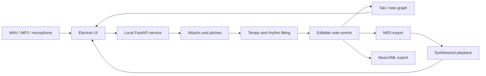

# Architecture

The app keeps the original recording and the detected notes separate. A note
is structured data; the original audio is a waveform. Editing notes changes
the generated playback and exports, not the source recording.



## Frontend

| File | Responsibility |
| --- | --- |
| `src/frontend/main.js` | Creates the Electron window and checks for the audio service. |
| `src/frontend/preload.js` | Exposes the local API address through Electron's isolated bridge. |
| `src/frontend/index.html` | Controls and accessible labels. |
| `src/frontend/css/styles.css` | Layout, control states, and responsive styling. |
| `src/frontend/js/app.js` | Project state, requests, sheet drawing, playback seeking, and editing. |
| `src/frontend/js/recorder.js` | Microphone capture, PCM buffering, WAV encoding, and silence tracking. |

The browser code does not have Node access. Microphone samples arrive through
an AudioWorklet. The canvas renders notes from API responses and places the
playhead at the current audio time. Scrolling changes the visible section;
seeking changes the playback position.

## Backend

| File or folder | Responsibility |
| --- | --- |
| `api.py` | HTTP routes, file handling, and the in-memory project store. |
| `models.py` | Validates tempo, rhythm, and edit requests with Pydantic. |
| `audio_processing/transcription.py` | Selects the detector and applies playable-string constraints. |
| `audio_processing/loader.py` | Loads recordings as mono samples at 22,050 Hz. |
| `audio_processing/melody_transcription.py` | Finds attacks, checks new harmonic energy, and estimates one fundamental pitch per attack. |
| `audio_processing/chord_transcription.py` | Aligns simultaneous pitches to attacks and suppresses harmonics already explained by selected notes. |
| `audio_processing/fast_transcription.py` | Uses shorter windows for closely spaced attacks. |
| `audio_processing/playing_confirmation.py` | Checks sustained tonal evidence before starting a take. |
| `audio_processing/tempo_estimation.py` | Estimates the beat and uses regular attack patterns to refine its interpretation. |
| `audio_processing/quantization.py` | Groups chords, fits rhythmic intervals, and applies intended spacing. |
| `audio_processing/neural_transcription.py` | Optional Basic Pitch inference and repeated-pluck cleanup. |
| `audio_processing/onset_analysis.py`, `pitch_detection.py`, `articulation.py` | Earlier DSP fallback and neural articulation helpers. |
| `audio_processing/midi_export.py` | Converts note events into MIDI tracks with pretty_midi. |
| `sheet_music/fingering.py` | Chooses playable string/fret combinations. |
| `sheet_music/staff.py`, `tablature.py` | Write measured MusicXML with music21. |
| `playback/sync.py` | Synthesizes MIDI, or mixes it with unmodified original audio. |
| `editor/` | Note/track helper classes and drum, bass, and keyboard accompaniment. |

The current API stores notes as dictionaries. The older Note and Track classes
are helpers, not the data model used throughout the active UI. Accompaniment
has an API route but no current frontend controls.

## A recording's path through the system

1. `/upload` stores audio in a temporary project folder and loads its samples.
2. `/transcribe/{id}` calls `transcribe_audio`. Melody and chord modes use
   separate detectors; Basic Pitch is optional.
3. The detector proposes attacks, estimates pitches, and rejects weak evidence.
4. Tempo estimation produces BPM. Leading silence can be removed from the
   note timeline while retaining an offset into the source recording.
5. Rhythm fitting creates beat-aligned notes without inventing or dropping
   events. The project retains performed notes for timing changes and undo.
6. The response includes notes and tab positions. The frontend draws them.
7. `/edit`, `/timing`, and `/tempo` change structured notes. Playback and exports
   read the resulting track, so they reflect the sheet.

Example note data:

```json
{
  "pitch": 55,
  "start": 0.125,
  "end": 0.22,
  "velocity": 80,
  "beat_duration": 0.25
}
```

Pitch 55 is G3. Start/end are seconds; velocity is relative loudness on a
1–127 scale. `beat_duration` is measured in quarter-note beats: 0.25 is a
sixteenth. Its sounding end can be shorter to retain a staccato release.

At 120 BPM, one beat is 60/120 = 0.5 seconds, and a sixteenth is 0.125 seconds.
There are 16 sixteenths in a 4/4 bar. BPM changes scale seconds; the beat
positions remain the same.

## Live recording

The UI sends up to four seconds of buffered audio about every 700 ms, with
one request in flight. `/live` does not create saved projects. Tonal evidence
confirms that playing began, and the earlier samples retain the first pluck.
Setup noise is excluded from silence calibration.

Overlapping snapshots replace provisional notes in the reliable region.
Window boundaries wait for more context. After Stop, the whole take is
transcribed again. This is a responsive preview, not a hard real-time audio
engine or guaranteed final transcription while recording.

## Tab assignment

Standard tuning is represented by MIDI pitches `[64, 59, 55, 50, 45, 40]`,
from high e to low E. Fret = detected pitch − open-string pitch. The solver
enumerates playable assignments within frets 0–24, prevents chord notes from
sharing a string, and favors a compact fret span. Single notes prefer lower
frets. Top/bottom string selections restrict available choices.

A pitch can occur on more than one string. The solver provides a playable tab;
it cannot reconstruct the player's exact hand position from pitch alone.

## Persistence and deployment

- Open projects are in memory and are lost when the service restarts.
- Uploads and exports use a temporary directory. Explicitly saved recordings
  go to the source project's `recordings/` folder.
- `start.bat` calls `tools/launch_app.py`, which reuses or starts the local
  service before opening Electron.
- Build scripts use PyInstaller and electron-builder. Source-launch checks
  do not establish that a packaged installer works on every machine.
- This is a single-user local prototype. CPU-intensive detection currently
  runs in request handlers; multiple-user deployment would need workers,
  persistence, request limits, and a narrower access policy.
